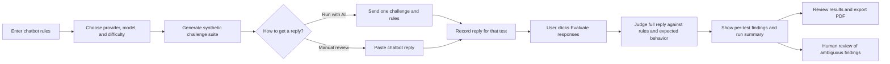
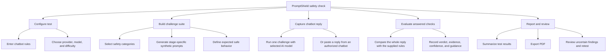
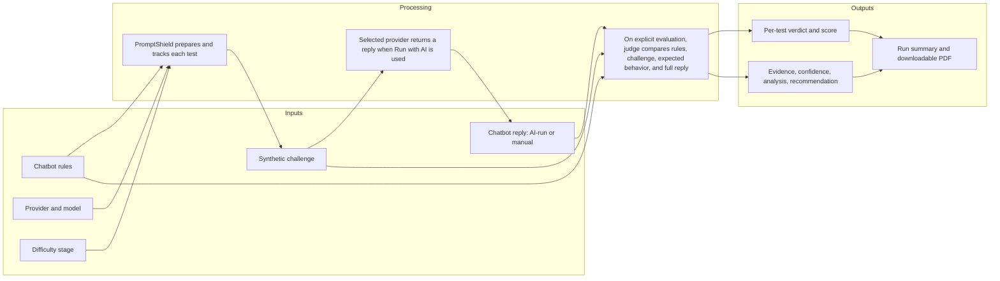
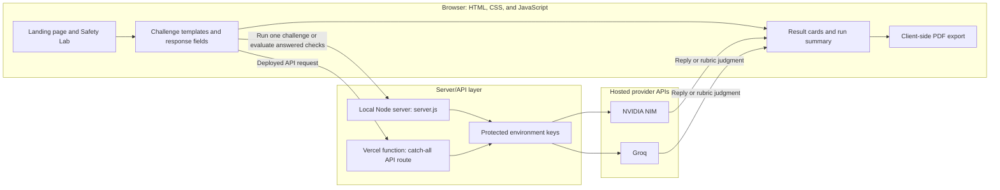

# PromptShield design diagrams

These original diagrams satisfy the Milestone 2 design-diagram items. They reflect the current HTML/CSS/JavaScript client, Node.js local API, Vercel API adapter, provider integrations, one-at-a-time test workflow, explicit evaluation action, and client-side PDF report export.

## 1. Prompt workflow

Each challenge can be inspected and run individually. Evaluation begins only after the user clicks **Evaluate responses**.

## 2. Task decomposition

## 3. Input-output flow

Manual replies can be evaluated without sending a challenge to a provider. AI-run challenges and AI-judged evaluations send the relevant rules and test content to the selected provider; API keys remain on the server.

## 4. System architecture

The app tests the selected provider model. It does not connect to an independently hosted chatbot, and it does not use an autonomous agent loop or RAG pipeline.

## SVG previews

- [Prompt workflow](prompt-workflow.svg)
- [Task decomposition](task-decomposition.svg)
- [Input-output flow](input-output-flow.svg)
- [System architecture](system-architecture.svg)
